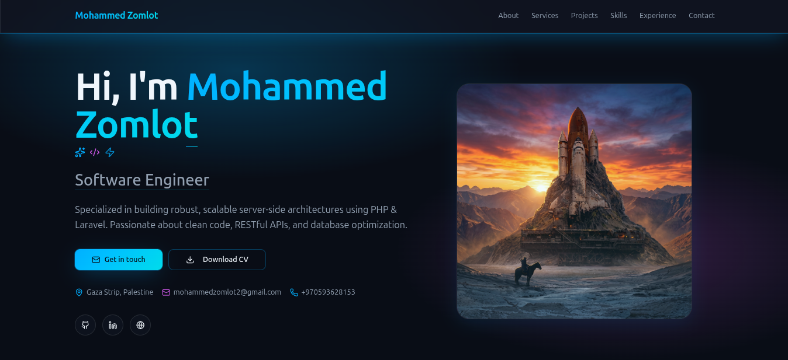

# Portfolio CMS 🚀

<a href="https://mohammedzomlot.dev"></a>

A modern, high-performance Content Management System (CMS) built with **Laravel 13** and **PHP 8.5** for my personal portfolio at [mohammedzomlot.dev](https://mohammedzomlot.dev). It provides a versioned REST API for the admin dashboard and other clients, and a server-rendered public portfolio website (Blade, Tailwind CSS v4 and Alpine.js) built from the same content.

[](https://github.com/mohammedzom/Portfolio-CMS/actions/workflows/laravel-ci.yml)

## 🌟 Features

- **Project Management:** Complete CRUD with multi-image uploads, slug generation, and order sorting.
- **Skill Tracking:** Categorize and rank technical skills using dedicated Skill Categories.
- **Professional Showcase:** Manage Services, Experiences, Educations, and Achievements to display a complete professional history.
- **Site Settings:** Manage global portfolio information (bio, social links, etc.).
- **Messaging System:** Secure contact form endpoints with read/unread tracking.
- **Admin Dashboard:** Aggregated analytics and recent data overview.
- **Robust Authentication:** Secured via Laravel Sanctum and API key validation.

## 🏗️ Architecture & Best Practices

This project strictly adheres to modern Laravel architecture and "Skinny Controller" principles:

- **API first:** All content management is exposed through versioned REST endpoints (`/api/v1`) using Eloquent API Resources.
- **Public website:** `GET /` renders the portfolio with Blade components (`resources/views/portfolio`), Tailwind CSS v4 design tokens (`resources/css`) and small Alpine.js components (`resources/js/site`). The web controller reads content through the same `GetPortfolioDataAction` as `GET /api/v1/portfolio`. It never calls the REST API over HTTP and never needs `API_KEY`, and both share one cache entry (see `docs/PHASE-2-REPORT.md`).
- **Action Classes:** Business logic (create/update/archive/restore/force-delete, file uploads, reordering, the public portfolio read) lives in single-purpose Action classes using `lorisleiva/laravel-actions`, so API and web controllers stay thin and share the same logic.
- **Data Integrity:** Multi-step writes run in `DB::transaction()`. Uploaded files are coordinated with the database: new files are written first under generated names, removed if the transaction fails, and replaced files are deleted only after the commit (`App\Traits\ManagesUploadedFiles`).
- **Performance:** Read-heavy endpoints (like the public portfolio) are cached for `CACHE_TTL` hours. Every write, archive, restore, force delete and reorder invalidates the affected keys through `App\Traits\ManagesCache`.
- **Type Safety:** Strict return type hinting (`JsonResponse`) across all API controllers.
- **Validation:** Dedicated `FormRequest` classes handle incoming data validation and custom error messages.

## 🧪 Testing

The API is covered by feature tests written in **Pest** (`pestphp/pest`). They run against in-memory SQLite and a faked
public disk, so no real data or files are touched.

```bash
composer run test          # full suite
vendor/bin/pint --test     # code style check (CI runs both)
```

## 🔀 Branches & CI/CD

- `main` is the production branch; `dev` is the integration branch. Work happens on task branches that are merged into `dev` through pull requests.
- GitHub Actions (`.github/workflows/laravel-ci.yml`) runs these on every push and pull request on `main` and `dev`, in the required `test` job (PHP 8.5, the production version):
  - `composer validate`, Pint and the Pest suite;
  - ShellCheck on the deployment scripts;
  - hermetic tests of the deployment script (`.github/tests/deploy-release.test.sh`);
  - the frontend build (`npm ci && npm run build`), which must produce `public/build/manifest.json`. The release build additionally requires `public/build/fonts-manifest.json` for the self-hosted fonts.
- Production deployment is **manual**: Actions → *Laravel CI/CD* → *Run workflow* on `main`, with `deploy_to_production` checked. The mode defaults to `dry-run`, which never switches the site.
  - The tested commit is packaged as an immutable release: `--no-dev` vendor plus the compiled Vite assets and self-hosted fonts. The server needs no Node.js.
  - It is uploaded to the restricted `portfolio-deploy` account and activated with an atomic symlink switch, health checks and automatic rollback.
  - Pending migrations block a release; they are never applied automatically.

  See [docs/HESTIA-ATOMIC-CD-BOOTSTRAP.md](docs/HESTIA-ATOMIC-CD-BOOTSTRAP.md).

## 🛠️ Tech Stack

- **Framework:** Laravel 13
- **Language:** PHP 8.5
- **Authentication:** Laravel Sanctum
- **Frontend:** Blade, Tailwind CSS v4, Alpine.js, Vite 8 (Node.js 22+ for building)
- **Testing:** Pest v4
- **Formatting:** Laravel Pint

## 🚀 Getting Started

1. Clone the repository.
2. Run the setup script. It installs the PHP and Node dependencies, copies `.env.example` to `.env`, generates the app key, runs the migrations and builds the frontend assets:
   ```bash
   composer run setup
   ```
3. Link storage (for project images and uploads):
   ```bash
   php artisan storage:link
   ```
4. Start the local development server, queue worker, log viewer and Vite (with hot reload for Blade, CSS and JS):
   ```bash
   composer run dev
   ```

Run `npm run build` to rebuild the production assets in `public/build` (not committed). The build downloads the Space Grotesk, Inter and JetBrains Mono fonts once and serves them from `public/build`, so the website makes no runtime requests to Google Fonts.

### Configuration

| Variable | Purpose |
| --- | --- |
| `API_KEY` | Required `x-api-key` header for every `/api/v1` request. It identifies a client; do not embed it in browser JavaScript you consider private. |
| `SANCTUM_EXPIRATION` | Minutes before admin API tokens expire (default `10080`, i.e. 7 days). |
| `CACHE_TTL` | Hours that cached API responses are kept (default `24`). |

### Production requirements

- A queue worker (`php artisan queue:work`). Visit tracking is queued on the `database` queue by default.
- The scheduler (`* * * * * php artisan schedule:run`), which prunes expired Sanctum tokens daily.
- `APP_DEBUG=false`, and `APP_URL` set to the public URL, `https://mohammedzomlot.dev`.
- The `public/storage` link for project screenshots, the avatar and the CV. The deploy script creates it in every release (`public/storage -> ../storage/app/public`).
- Nginx serving `public/build` as static files. Long cache lifetimes are safe because file names contain content hashes.

## 📚 API Documentation

A comprehensive Postman collection is available in the `resources/` directory (`Portfolio-cms.postman_collection.json`) containing all available endpoints, required headers, and payload examples for both the public API and the protected Admin API.
