# Phase 2 Report — Interactive Prototype to Laravel Blade

**Scope:** convert the approved interactive portfolio prototype (`prototype-v1.zip`, Crimson × Obsidian) into the Laravel application as a Blade + Tailwind CSS v4 + Alpine.js website, powered by the real CMS content, without changing the REST API and without deploying.

**Branch:** all work was merged into `dev` through task PRs. `main` and production were not touched by this phase, and no GitHub Release was created.

---

## 1. Summary

| Task | PR | Merge commit on `dev` |
| --- | --- | --- |
| A — Frontend foundation, design tokens, shared read actions | [#19](https://github.com/mohammedzom/Portfolio-CMS/pull/19) | `b395ac5` |
| B — Hero, request-trace diagram, navigation | [#20](https://github.com/mohammedzom/Portfolio-CMS/pull/20) | `ec11a10` |
| C — Projects: bento grid, filters, detail dialog | [#21](https://github.com/mohammedzom/Portfolio-CMS/pull/21) | `e613da8` |
| D — Expertise, stack, log, about, contact | [#22](https://github.com/mohammedzom/Portfolio-CMS/pull/22) | `56b636b` |
| E — SEO, visit tracking, accessibility and performance | [#23](https://github.com/mohammedzom/Portfolio-CMS/pull/23) | `acf23f4` |
| F — CI asset build and deployment readiness | [#24](https://github.com/mohammedzom/Portfolio-CMS/pull/24) | `35e34fd` |
| Report and screenshots | _this PR_ | — |

**Result:**
- `GET /` now renders the approved design from CMS data. The REST API is unchanged: 0 changed responses, and its tests pass against both the old and new controllers.
- 132 Pest tests pass (539 assertions), up from 107 (421) at the end of Phase 1.
- 53 of 53 real-browser checks pass in Chromium on desktop, tablet and mobile, with reduced motion, and with JavaScript disabled.
- axe-core reports 0 accessibility violations.
- Lighthouse scores 99–100 on desktop and 87 for mobile performance, with accessibility, best practices and SEO at 100.

## 2. Inspection

**Prototype** (`index.html`, `assets/css/style.css`, `assets/js/data.js`, `assets/js/main.js`, 6 screenshots, README):
- **Stack:** static HTML, 861 lines of CSS and about 560 lines of vanilla JavaScript, with all demo content in `data.js`.
- **The "portfolio as an API" concept:** sections are presented as endpoints (`GET /work`…), and the hero is a live request trace through Client → Nginx → Laravel → Redis / MySQL inside a Linux VPS, with GitHub Actions deploying into it.
- **Interactions:**
  - Intro sequence; architecture node notes; trace, cache hit and deploy.
  - Navigation: active state, scroll progress, blurred bar and mobile menu.
  - Bento grid with pointer light and image curtain; filters with counts and a live region; native `<dialog>` with arrow-key stepping.
  - Expertise ARIA tablist with a travelling pipeline signal; stack-to-projects usage; scroll-linked timeline.
  - Copy email with a toast, the Crimson/Phosphor theme switch, and reduced-motion handling.

**Application:**
- **Models:** `Project`, `Service`, `Skill`/`SkillCategory`, `Experience`, `Education`, `Achievement` and `SiteSettings`, all soft-deleting except `SiteSettings`.
- **Existing read path:** public API resources plus the cached `portfolio_all` payload in `Api\V1\PortfolioController`.
- **Writes:** Actions using `ManagesCache` already forget `portfolio_all` on every write.
- **Guidelines:** `CLAUDE.md`, `AGENTS.md`, the Phase 1 report, and the Boost skills `tailwindcss-development` and `testing-best-practices` were read. Laravel Boost `search-docs` was used for Vite, fonts and `withoutVite`, and `database-schema` / `database-query` for the schema and the imported content.

**Content used for development:** the owner exported the public content tables (`projects`, `skills`, `skill_categories`, `services`, `site_settings`, `experiences`, `achievements`, `education`) from production as `portfolio-content.sql.gz`.
- **Location:** the dump stays outside the repository and was never committed.
- **Schema check:** before importing, I confirmed the dump contained only those 8 tables (no users, tokens, messages or visits) and that every column matched the local migrations in name and order.
- **Import:** it was imported only into the local SQLite database by a parser that only accepts those tables and refuses to write into non-empty tables. The local database was backed up first.
- **Result:** 57 rows imported, with no foreign-key violations.
- **Media:** all 29 referenced media files (23 screenshots, avatar, CV, 4 certificates) exist in production; HEAD requests returned `200` for every one. The images were copied into the git-ignored local `storage/app/public` for screenshots. No local admin account was needed, because the admin API tests use factories.

## 3. Architecture

```
GET /  ──► Web\PortfolioController
             ├─ GetPortfolioDataAction   (shared with GET /api/v1/portfolio, cached as portfolio_all)
             └─ BuildPortfolioPageAction (view model: layout sizes, timeline, matches …)
           ──► resources/views/portfolio/index.blade.php
                 sections/*.blade.php + components/site/*.blade.php
           ──► resources/css (Tailwind v4 @theme tokens + one component file per section)
               resources/js  (Alpine components per interactive area)
```

- **Shared data access, no duplicated logic:**
  - The cached query moved unchanged from the API controller into `GetPortfolioDataAction`. The API now calls the action, and its response is identical; a new test pins the 404 for missing settings, and it passes against both controllers.
  - The website calls the same action directly. It **never calls the REST API over HTTP and never uses `API_KEY`**; a test asserts that no outbound HTTP request is made and that the key never appears in the HTML.
- **One cache, one invalidation path:** every admin write already calls `forgetPortfolioCache()`. A test edits a project through the admin API and sees the change on the website straight away.
- **`BuildPortfolioPageAction`** derives the presentation from CMS content only:
  - **Bento sizes:** fill the 12-column grid for any number of projects; six projects give exactly the approved layout.
  - **Descriptions:** split into paragraphs. The owner's existing "Core Contributions:" convention becomes the dialog's "What it involves" list, so no new field was needed.
  - **Tech matching:** "Laravel 13" matches the skill "Laravel", and "Git & GitHub" / "Linux/Unix" match either part.
  - **Services:** become expertise tabs. Their tags are the pipeline steps, and "Seen in" lists projects that share a tag.
  - **Timeline:** experience, education and achievements in one log, newest first. An achievement with an uploaded certificate is a "certificate"; otherwise it is an "award" with the filled marker.
  - **Links:** only `http(s)` URLs are rendered for projects and social links.
- **No schema or API changes:** missing optional data produces empty states or hidden sections instead of invented content.
- **Missing site settings:** if the settings row does not exist yet, the page still renders, with empty states.

## 4. Frontend

- **Tooling:** Vite 8.3.8, `laravel-vite-plugin` 3.2.1, Tailwind CSS 4.3.5 (`@tailwindcss/vite`) and Alpine.js 3.17.5. No React, Vue or Next.js. `npm audit` reports 0 vulnerabilities.
- **Design tokens:** the prototype's CSS custom properties are now Tailwind `@theme` tokens (colours, type scale, radii, easing), so they are available as utilities and as variables. Component CSS is split by section under `resources/css/site/`.
- **Fonts:** Space Grotesk, Inter and JetBrains Mono are downloaded at build time by `laravel-vite-plugin/fonts` and served from `public/build`, and `@fonts` preloads the key weights. The prototype loaded them from Google Fonts at runtime; that request is gone, which is better for performance and privacy.
- **JavaScript:** one Alpine component per interactive area (`siteNavigation`, `architectureTrace`, `projectGrid`, `projectDialog`, `expertiseTabs`, `stackUsage`, `copyEmail`) plus `page-effects.js` for page-wide behaviour (scroll state, reveals, active link, pointer light, image fallbacks, intro). The final build is 23.7 KB gzipped JS and 11.1 KB gzipped CSS, plus three self-hosted variable fonts (about 100 KB in total).
- **Blade components:**
  - `x-layouts.site`
  - `x-site.section-head`
  - `x-site.route`
  - `x-site.project-card`
  - `x-site.pattern` (the abstract placeholders, now rendered server-side)
  - `x-site.empty-state`
  - `x-site.external-icon`

## 5. Interactions preserved

All meaningful prototype interactions work on the Blade site, and each is checked in a real browser (section 7):
- **Hero:**
  - entrance stagger and the outline-to-solid headline
  - architecture notes on hover, focus and click
  - wires redrawn on resize
  - automatic first trace; cache miss, then cache hit, then **Ship a deploy** (cache cold again)
  - wire flow paused off-screen
- **Navigation:** route links, active-section underline, scroll progress, blurred bar, and the mobile menu (focus moves in, Escape closes, closes on link click or resize).
- **Projects:**
  - bento layout, pointer light and image reveal
  - filters with counts and `aria-pressed`, plus a live region
  - uniform grid when filtered
  - dialog: click or keyboard open; close button, Escape or backdrop close with animation; focus return; ←/→ stepping
- **Expertise:** tablist (arrow keys, Home and End), lit pipeline step with the travelling signal, and "Seen in" opening a project.
- **Stack:** technology to projects, with the honest message when none uses it.
- **Log:** scroll-linked progress line, reveal and award markers.
- **About and contact:** greyscale avatar that colours on hover, monogram fallback, copy email with a toast.
- **Reduced motion:** with `prefers-reduced-motion`, ambient motion is off, entrances are instant, traces complete instantly and nothing auto-runs.

## 6. Deliberate changes (each with its reason)

| Change | Reason |
| --- | --- |
| Crimson/Phosphor theme switch removed | The owner confirmed Crimson × Obsidian is final. |
| Faint text `#6c6c73` → `#83838a` | The prototype colour reached only 3.77:1 contrast. The new value is the closest same-hue grey that meets WCAG AA (4.5:1) on every surface it is used on. |
| Project card is an `<article>` with the button inside the title | A `<button>` wrapping headings and lists is invalid HTML and produced a very long accessible name. Clicking anywhere on the card still opens the dialog, and the card shows the focus ring through `:has()`. |
| Dialog shows screenshots whole (`contain`) over a blurred copy | `cover` cropped real UI screenshots heavily in the tall media column. Cards keep the cropped teaser. |
| Dialog body scrolls independently | In the prototype the grid row grew with long descriptions, so the links and the project navigation could not be reached. |
| Screenshot stepper in the dialog | Projects have up to 10 screenshots; the prototype only had one image per project. |
| Placeholders rendered in Blade behind each image | Broken images reveal the placeholder without swapping markup in JS, and the page reads correctly without JS. |
| Animation start states only apply when JS runs (`html.js`) | Without JS the prototype left revealed content invisible. |
| `<ol>` lists hold only `<li>` | The timeline fill and the pipeline dot moved out of the `<ol>` to make the markup valid. |
| Hero grid drift and pipeline signal use `transform` | `background-position` and `left` animations repainted or relaid the page every frame. Same visuals, compositor-only. |
| Placeholder grids drawn with one SVG `<pattern>` | Replaces 26 `<line>` elements per placeholder; the HTML goes from 128 KB to 108 KB. |
| Expertise copy uses the real count ("Two specialisations"); the pipeline has as many columns as the service has tags | The CMS has two services, not three. |
| Stack uses the monospace glyphs, not the CMS skill icon URLs | The external multi-colour icons break the approved palette and add third-party image requests. |
| Achievement "View certificate" / "Details" links | These links already exist in the CMS. |
| Footer reads "Served by Portfolio CMS · Laravel" | "Static build, no tracking" would be false: the site records visits. The Laravel version is not disclosed. |
| `GET /` records visits (`LogVisitor`) | Keeps the dashboard's visit analytics working once the website replaces the external frontend. |
| SEO: canonical, Open Graph, Twitter card, JSON-LD `Person` | Requested; the values come from the site settings. |

No contact form was added (the approved prototype deliberately has none), and no projects, statistics or achievements were invented.

## 7. Verification

**Automated tests:**
- **Suite:** `php artisan test` passes 132 tests (539 assertions), and `vendor/bin/pint --test` passes. CI passed on every task PR.
- **`PortfolioWebsiteTest`:**
  - hero from the settings, with no REST API call and the key absent from the HTML
  - projects with images and dialog data; archived content hidden
  - empty states and hidden sections
  - XSS escaping in the HTML and the embedded JSON
  - admin edits visible immediately
  - every section from the CMS
  - visit recorded on each page view
  - SEO metadata
- **`BuildPortfolioPageActionTest`:** layout sizes for 1–7 projects, description parsing, rejection of non-http links, skill and service matching, and timeline order and kinds.

**Real browser:** headless Chromium 151 (playwright-core driving the system browser), local server, imported production content. **53 of 53 checks passed**, including:
- **Hero:** automatic trace, wires, notes, cache hit, deploy.
- **Navigation:** scrolled state and active link.
- **Images:** none broken.
- **Filters:** counts, `aria-pressed` and reset.
- **Dialog:**
  - click, keyboard and tap open
  - focus moves to the close button and returns on close
  - close button, Escape and backdrop close it
  - ←/→ stepping and the screenshot stepper
  - links reachable by scrolling
  - page scroll restored after closing
- **Expertise:** tabs by keyboard, the pipeline animating after a click, "Seen in".
- **Stack:** usage and the honest empty case.
- **Contact:** copy-email toast.
- **Responsive:** no horizontal overflow on tablet (834 px) and mobile (390 px). On mobile the menu moves focus in, closes on Escape and navigates.
- **Reduced motion:** no automatic trace; the manual trace is instant; content is visible.
- **No-JS:** content visible.
- **Errors:** no console errors in any run.

With every image request blocked, all 6 cards and the dialog showed their placeholders and the avatar its monogram.

**Accessibility:** axe-core 4 (WCAG 2.0/2.1 A and AA plus best practices) reports **0 violations** on desktop and mobile, with the dialog both closed and open.

**Lighthouse 12** (local `php artisan serve`, no gzip and no cache headers):

| | Performance | Accessibility | Best practices | SEO | Key metrics |
| --- | --- | --- | --- | --- | --- |
| Desktop | 99–100 | 100 | 100 | 100 | LCP 0.7 s, CLS 0, TBT 10 ms |
| Mobile (simulated slow 4G, 4× CPU) | 87 (75 before task E) | 100 | 100 | 100 | LCP 3.1 s, CLS 0, TBT 200–220 ms |

**Visual comparison:** screenshots of the Blade site were compared with the prototype's `desktop-hero`, `desktop-full`, `mobile-hero` and `project-dialog` renders. Layout, typography, palette, spacing and composition match. The visible differences are the real content and the deliberate changes in section 6.

**Final re-run on the merged `dev` code (`35e34fd`):**
- 53 of 53 browser checks passed.
- axe-core reported 0 violations on desktop and mobile, with the dialog both closed and open.
- With every image request blocked, all 6 cards and the dialog showed their placeholders and the avatar its monogram, with no page errors.

The screenshots in section 10 come from this run.

## 8. Content observations for the owner

These are CMS data, not code, and were left as they are:
- `site_settings.tagline` is "Software Engineer"; the prototype used "Backend Engineer & DevOps Specialist". The site shows what the CMS stores.
- Archived demo rows from earlier development (demo services, "Acme Studio" experiences, demo certificates, and test rows such as a project titled "فثس" and an achievement titled "a") are soft-deleted, so they never render. They can be permanently deleted from the dashboard.
- Projects store full-size PNG screenshots (7.6 MB in total). Lighthouse estimates about 2.8 MB could be saved on desktop with responsive WebP images (section 11).

## 9. CI/CD readiness

> **Superseded on `main`.** This section describes `dev`'s CI and in-place deploy as of Phase 2.
> When Phase 2 was integrated into `main`, `main`'s release pipeline was kept instead:
> - CI runs on PHP 8.5, the version production now uses;
> - deploys are manual, and each release is an immutable artifact that includes the Vite build and fonts;
> - releases are switched in atomically, with health checks and automatic rollback.
>
> `frontend-<sha>.tar.gz`, `~/.portfolio-deploy/` and the PHP 8.4 jobs below are no longer used. See
> [HESTIA-ATOMIC-CD-BOOTSTRAP.md](HESTIA-ATOMIC-CD-BOOTSTRAP.md).

**CI:**
- **`test`, the required check:** now runs on **PHP 8.4**, the version production reports (8.4.27). Before, it ran on 8.5, which production does not use. It adds Node 24, `npm ci` and `npm run build`, and checks that `public/build/manifest.json` and `fonts-manifest.json` exist. Then it runs `composer validate`, Pint and the tests as before. Every PR now proves that the assets build.
- **New `test (PHP 8.5)` job:** runs the suite on 8.5, which is used for local development. The required check name stays `test`, so branch protection is unchanged.

**PHP compatibility with production:** see section 9.1.

**Deployment: how production gets the built assets.** `public/build` is git-ignored, and the server should not need Node.js. The `deploy` job (pushes to `main` only, after `test`) now:
1. Checks out the tested commit, runs `npm ci && npm run build`, verifies both manifests, and packs `public/build` into `frontend-<sha>.tar.gz`.
2. Uploads that **single file** to `~/.portfolio-deploy/` on the server, outside the project. It uses `appleboy/scp-action@v0.1.7` with the same host, user, key and port secrets as the SSH step; its `rm` option is not set, so nothing already in that directory is deleted.
3. **Before maintenance mode:**
   - refuses a missing archive;
   - refuses an archive with **any entry outside `build/`** (absolute paths, `..`, or extra top-level files);
   - refuses an archive containing **anything but regular files and directories** (symlinks, hardlinks, devices, FIFOs). Without this, a link inside `build/` could expose files outside the web root once `public/build` is served;
   - unpacks into a per-commit staging directory (`--no-same-owner`);
   - refuses an archive without the Vite manifests;
   - keeps the existing checks (clean working tree, fast-forward only).

   The only project path the deploy writes for assets is `public/build`.
4. **During maintenance mode,** after `git merge --ff-only` and `composer install`: moves the old `public/build` aside, moves the new build in, then runs migrations, the caches and `queue:restart`.
5. **On failure,** rollback puts the previous `public/build` back (or removes the half-installed one on a first deploy), resets the code, rebuilds the caches and leaves maintenance mode.
6. **On success,** removes the previous build, the staging directory and the archive.

**Validated without deploying:** the exact script was extracted from the workflow and run against a throwaway Git "server" checkout with stubbed `php`/`composer`. **12 of 12 scenarios passed:**
- normal deploy
- first deploy with no existing build (the state production is in today)
- missing archive (refused before maintenance mode)
- archive without a manifest (refused before maintenance mode)
- archive with a `build/../../.env` entry (refused before maintenance mode)
- archive with an extra top-level `index.php` (refused before maintenance mode)
- archive with an absolute path `/tmp/…` (refused before maintenance mode; nothing written outside the staging directory)
- archive with a symlink `build/assets/passwd → /etc/passwd` (refused before maintenance mode)
- archive with a hardlink (refused before maintenance mode)
- `composer install` failure (code rolled back, assets untouched)
- migration failure after the swap (previous code and assets restored)
- failure on a first deploy (half-installed assets removed)

**Real build archive:**
- A fresh `npm ci` (0 vulnerabilities) and `npm run build` produced `public/build/manifest.json` (968 B) and `public/build/fonts-manifest.json` (9.2 KB).
- Packed exactly as the deploy job packs it, the archive is 140 KB with 10 entries, all of them regular files or directories, and the deploy's safety checks accept it.

`appleboy/scp-action` itself could not be exercised without a real server.

**Deployment stays restricted to `main`:** the `deploy` job keeps `if: github.ref == 'refs/heads/main' && github.event_name == 'push'` and now `needs: [test, test-php-8-5]`. All new build, upload and SSH steps run inside that job, so pull requests and `dev` pushes never build release archives, read the server secrets or reach the server. Every Phase 2 PR run shows `deploy` as skipped.

### 9.1 PHP compatibility with production (PHP 8.4.27)

All checks below ran locally with the PHP 8.4.27 CLI, the same patch version production reported:

| Check | Result |
| --- | --- |
| `php8.4 -l` on every PHP file in `app`, `routes`, `config`, `database`, `bootstrap` and `tests` | 183 of 183 files: no syntax errors |
| Full test suite with `php8.4 artisan test` | 132 passed (539 assertions) |
| Full test suite with PHP 8.5 (local development) | 132 passed (539 assertions) |
| `composer check-platform-reqs --lock`, run with PHP 8.4 (with and without dev dependencies) | All requirements satisfied (exit 0). The lock needs PHP `>= 8.4.1`. |
| PHP 8.5-only syntax | None. A pipe operator (`|>`) used during development was removed before Task A was committed. |

CI now runs the required `test` check on PHP 8.4 and the separate `test (PHP 8.5)` job on 8.5, so a change that breaks either version fails before merging.

| PR | Merge commit on `dev` | CI |
| --- | --- | --- |
| [#24](https://github.com/mohammedzom/Portfolio-CMS/pull/24) | `35e34fd` | **`test`** (installed PHP 8.4.27; frontend built; 132 passed, 539 assertions): pass · **`test (PHP 8.5)`** (PHP 8.5.12; 132 passed): pass · `deploy`: skipped |

### Deployment prerequisites (before releasing Phase 2 to `main`)
- **Production `.env`:** `APP_URL=https://papi.mohammedzomlot.online` (or the final public host), because canonical and Open Graph URLs and the cached image URLs use it. Keep `APP_DEBUG=false`.
- **Upload directory:** the deploy user can write to `~/.portfolio-deploy/`, which `scp-action` creates.
- **Nginx:** serves `public/build` (already under the web root) with long cache headers and gzip/brotli.
- **Cache:** after the release, the first request rebuilds `portfolio_all`. Clearing it once (`php artisan cache:forget portfolio_all`) is harmless if image URLs were cached under another host.
- **Existing requirements:** the queue worker (visits are queued) and the scheduler from Phase 1 still apply.
- **Owner decision on the URL:** after a release, `GET /` on `papi.mohammedzomlot.online` would stop redirecting to `https://mohammedzomlot.dev` and serve the Blade site. Which address becomes the public one is the owner's decision. The options are keeping the current React frontend on `mohammedzomlot.dev`, pointing `mohammedzomlot.dev` at the Laravel app, or using another host. **Phase 2 changed no DNS records and no production routing, and nothing was deployed.**

### Rollback risks
- **No migrations:** Phase 2 adds none, so a code rollback is schema-compatible.
- **Rolling back to v1.1.0:** this restores the external-frontend redirect on `/`; the API is unaffected either way.
- **Leftover archives:** a failed deploy leaves its archive and staging directory in `~/.portfolio-deploy/` (about 150 KB). The next run clears the staging directory; old archives can be deleted by hand.
- **Untested against the server:** the asset upload step (`scp-action`) and the swap have only been simulated. Watch the first Phase 2 deploy.

## 10. Screenshots

These are renders of the Blade site with the real CMS content: headless Chromium 151 on the merged `dev` code (`35e34fd`), saved as WebP. The desktop full page is downscaled by half.

| | |
| --- | --- |
| **Desktop: hero, after the automatic request trace** 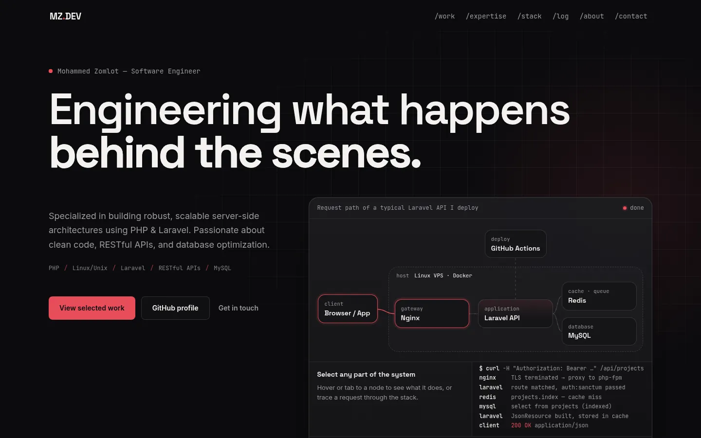 | **Desktop: projects (bento grid)** 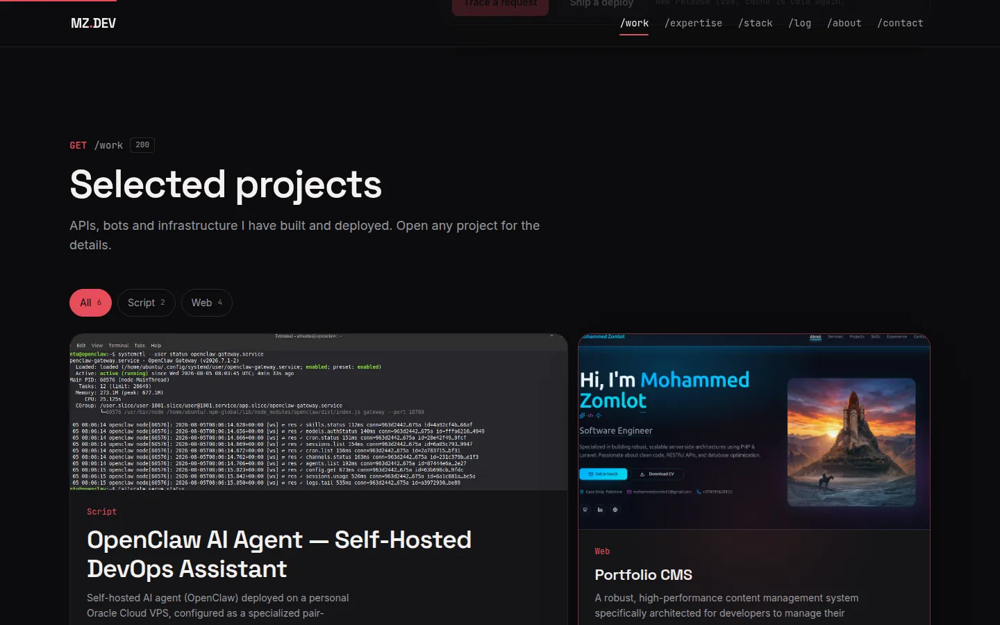 |
| **Desktop: projects filtered to "Script"** 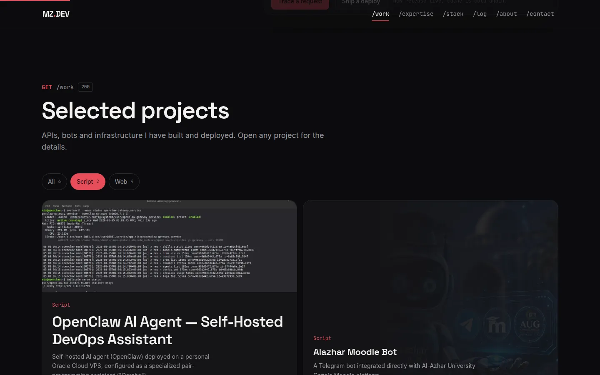 | **Desktop: project dialog with the screenshot stepper** 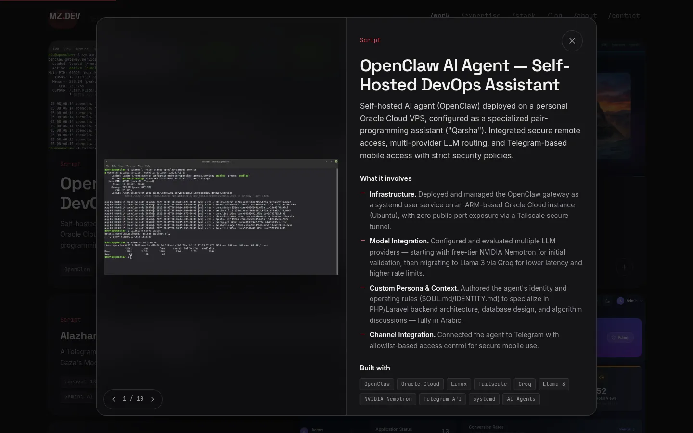 |
| **Desktop: expertise pipeline** 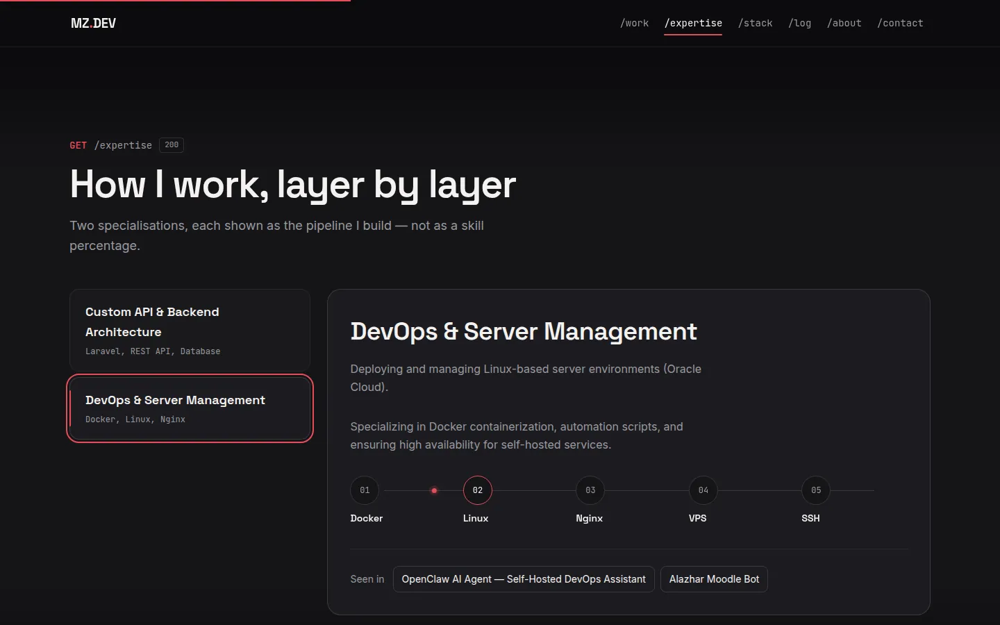 | **Desktop: stack and project usage** 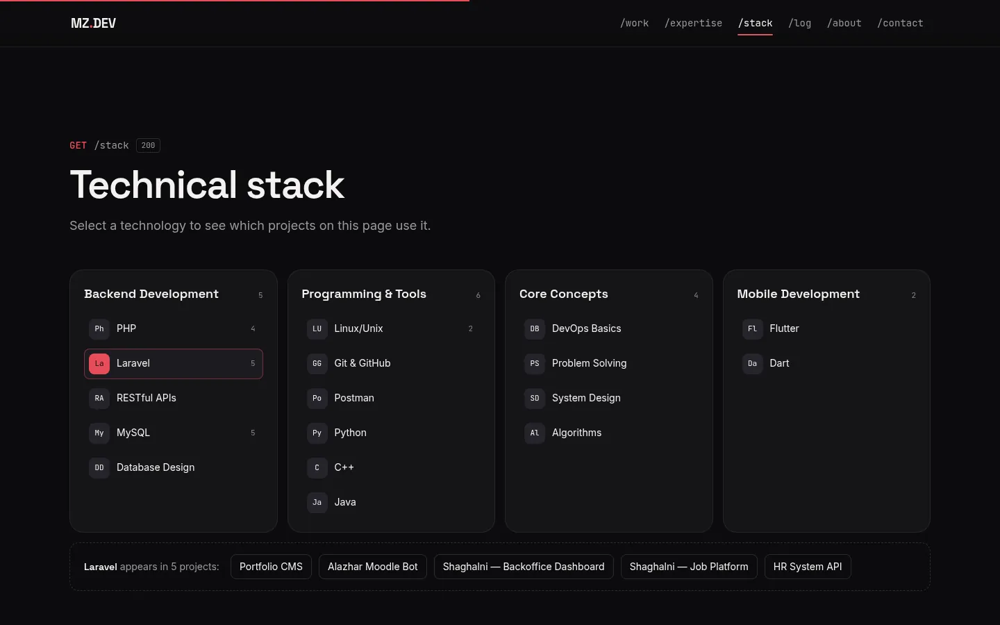 |
| **Desktop: contact** 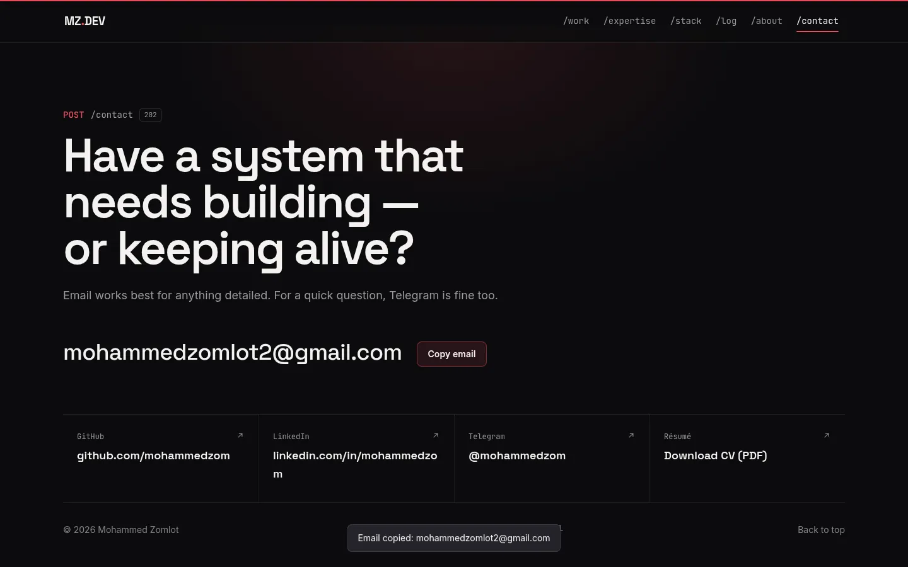 | **Desktop: image fallbacks (all images blocked)** 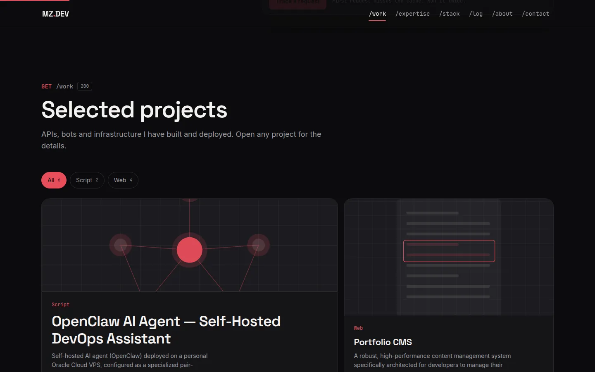 |
| **Tablet (834 px): hero** 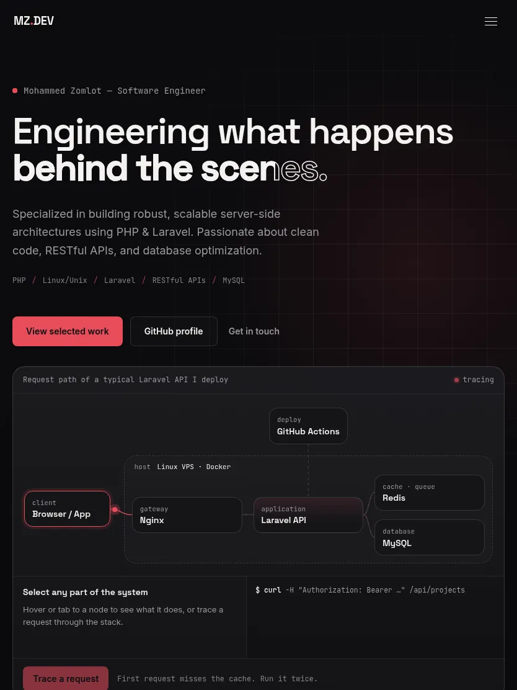 | **Mobile (390 px): hero** 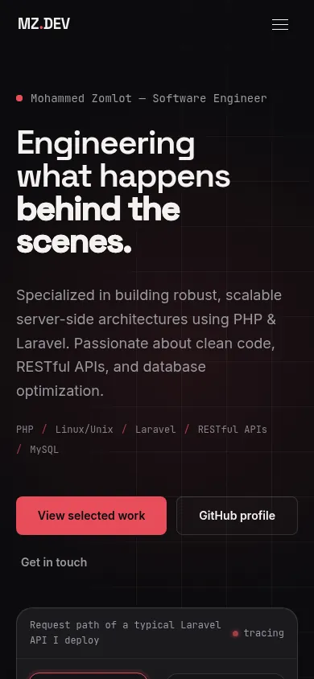 |
| **Mobile: menu** 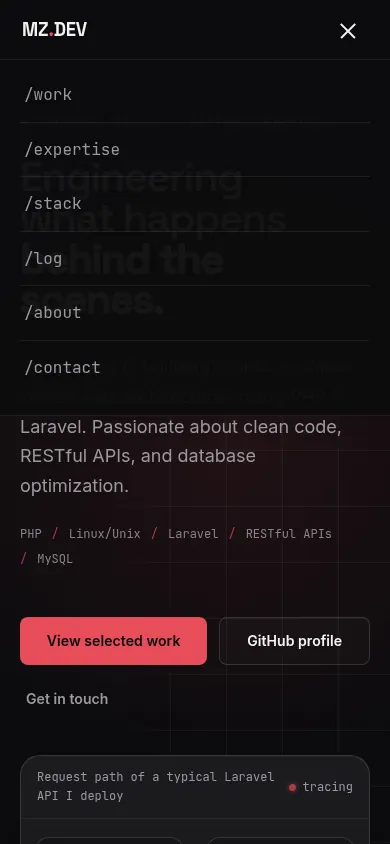 | **Mobile: project dialog** 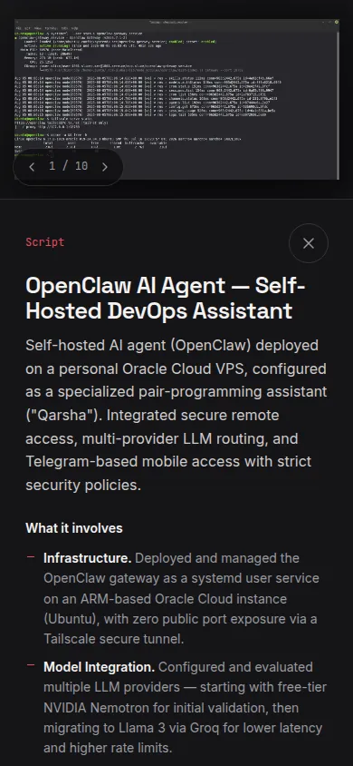 |

Full pages: [desktop](phase-2/desktop-full.webp) · [mobile](phase-2/mobile-full.webp).

The approved prototype's own renders (`prototype-v1/screenshots/`) were used for the side-by-side comparison in section 7. They are not committed, because they belong to the design hand-off rather than the repository.

## 11. Known limitations and recommended follow-ups

- **Responsive images:** generate WebP variants (for example 640/1280 px) when screenshots are uploaded and serve them with `srcset`. This is the largest remaining performance gain, and it needs an image-processing dependency, so it waits for the owner's approval.
- **Mobile LCP:** 3.1 s in the simulated slow-4G test; production gzip and caching will lower it. Metric-matched font fallbacks (`fontaine`, an optional dev dependency of the font plugin) would reduce font-swap shift further, but CLS is already 0.
- **Project pages:** project details live in the dialog, and there are no per-project URLs (`/projects/{slug}`) for sharing or SEO yet.
- **Contact:** the site has no contact form, following the prototype. The CMS's `POST /api/v1/message` remains available for a later form.
- **Visitor IPs:** visit tracking stores raw IPs, as in Phase 1. Hashing them or setting a retention period is still the owner's decision.
- **Admin dashboard:** it is still the external frontend; no Blade admin was built in this phase.
